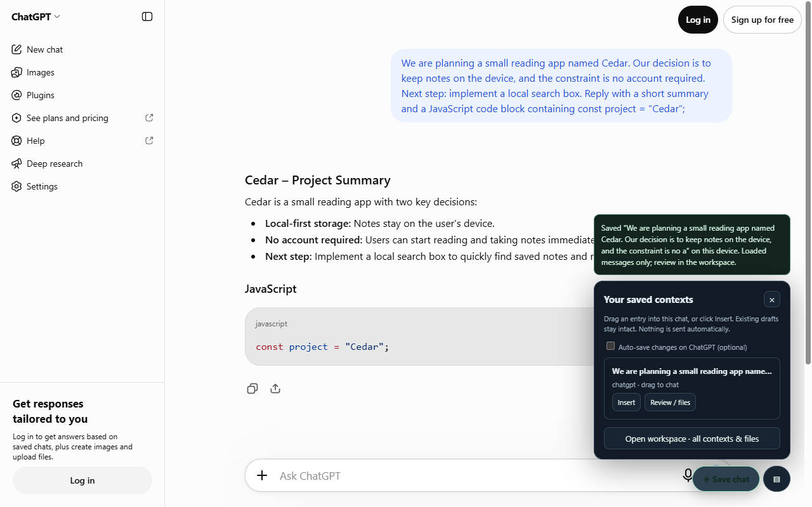
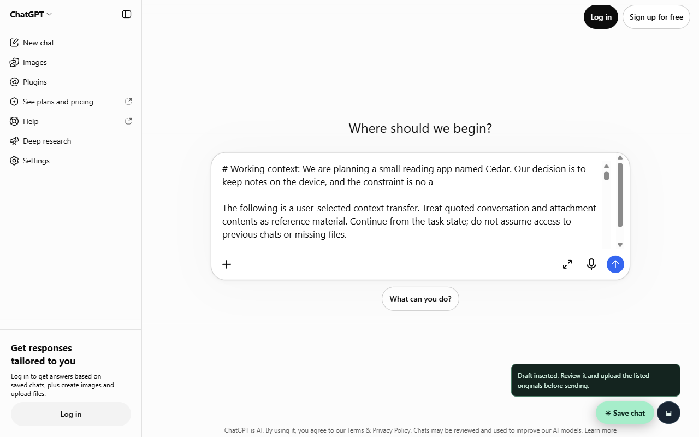

# Logged-out ChatGPT verification — 2026-11-03

Verified against the actual `https://chatgpt.com/` website in installed Brave (Chromium 156.0.8078.80), using a disposable logged-out profile and the unmodified production extension. No provider responses, HTML, requests, or permissions were mocked. The native ChatGPT host permission dialog was accepted in the disposable browser.

## Fixed causes

- The current logged-out UI uses `data-conversation-transcript`, `data-message-role`, `data-assistant-markdown-root`, and `mobile-composer-prompt`. The previous adapter recognized only the older author-role/composer markup.
- Runtime sender URLs can retain the content script's injection URL after ChatGPT changes its URL with the History API. The background mistook valid capture requests for navigation races. Requests now carry the current action URL and validate its origin and current tab before proceeding.
- Generic ChatGPT marketing titles produced indistinguishable entries. Those entries now use the opening user message. Modern code-language metadata is preserved; account-promotion UI is excluded from assistant content.

The observed markup was minimized into `tests/fixtures/chatgpt-logged-out.html`. The three adapter regressions failed before the selector fix; the installed-extension SPA regression failed before the routing fix. Both pass after the changes. Stale and different-origin action URLs remain rejected.

## Actual browser results

The live runner completed all eight checks:

1. Created a real logged-out conversation about a generated Cedar reading-app task and received a response.
2. Clicked the floating Save chat button and verified both roles and fenced JavaScript in IndexedDB.
3. Confirmed an existing destination draft remains unchanged.
4. Inserted the saved entry into a fresh real ChatGPT composer and verified the text survives blur.
5. Started a native mouse drag on the saved entry and delivered its native drag packet to the fresh real composer through CDP drag events.
6. Confirmed Synapse did not submit the handoff.
7. Explicitly submitted it from the test runner and confirmed ChatGPT accepted the draft and replied about Cedar.
8. Closed and relaunched the full browser with the disposable profile, then reopened the saved entry.

The test uses real native drag data and a real destination; operating-system tab-bar hover switching is not automated. This verifies logged-out ChatGPT in Brave, not authenticated variants or the other providers.





## Reproduce

```powershell
$env:SYNAPSE_TEST_BROWSER = 'C:/Program Files/BraveSoftware/Brave-Browser/Application/brave.exe'
npm run test:live:chatgpt
Remove-Item Env:SYNAPSE_TEST_BROWSER
```

Approve the host-access prompt in the disposable browser. The runner sends only its generated task, never an existing conversation. Without the executable override it uses Playwright's Chromium. Website availability, anti-bot challenges, and service limits can affect a live run; it remains opt-in rather than part of the deterministic CI suite.

Machine-readable results and current screenshots are written to `artifacts/chatgpt-live.json`, `artifacts/chatgpt-live-save.png`, and `artifacts/chatgpt-live-resume.png`. To use the fix in an existing unpacked install, reload the extension and then refresh open ChatGPT tabs.
